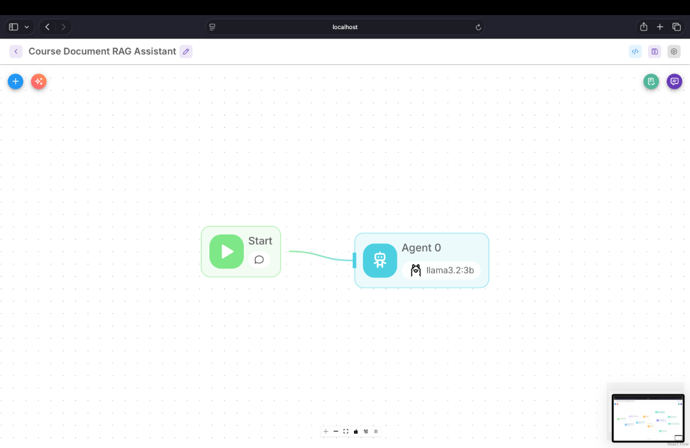
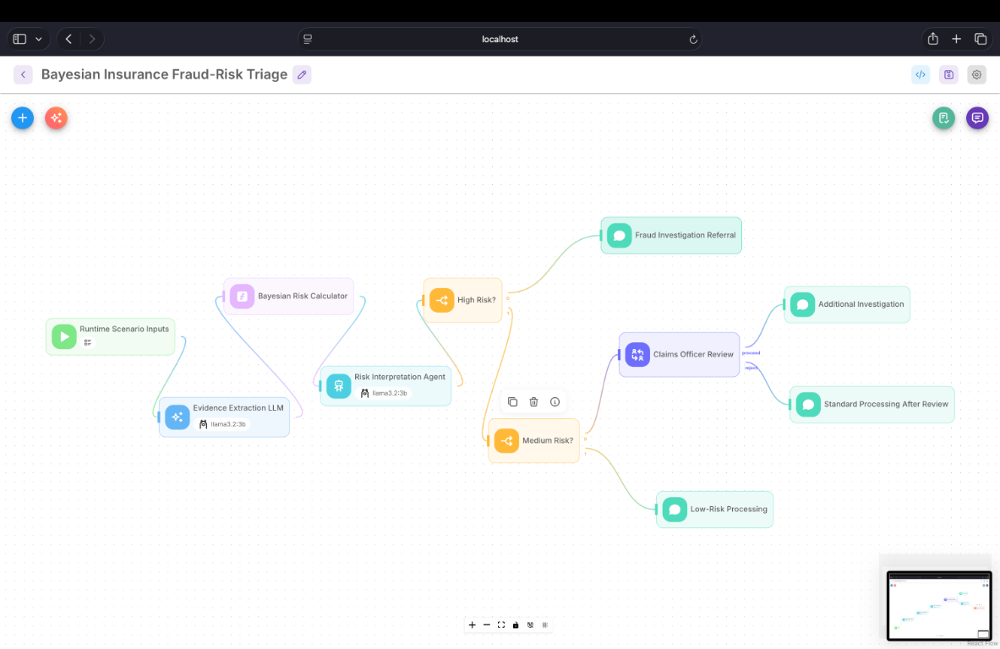
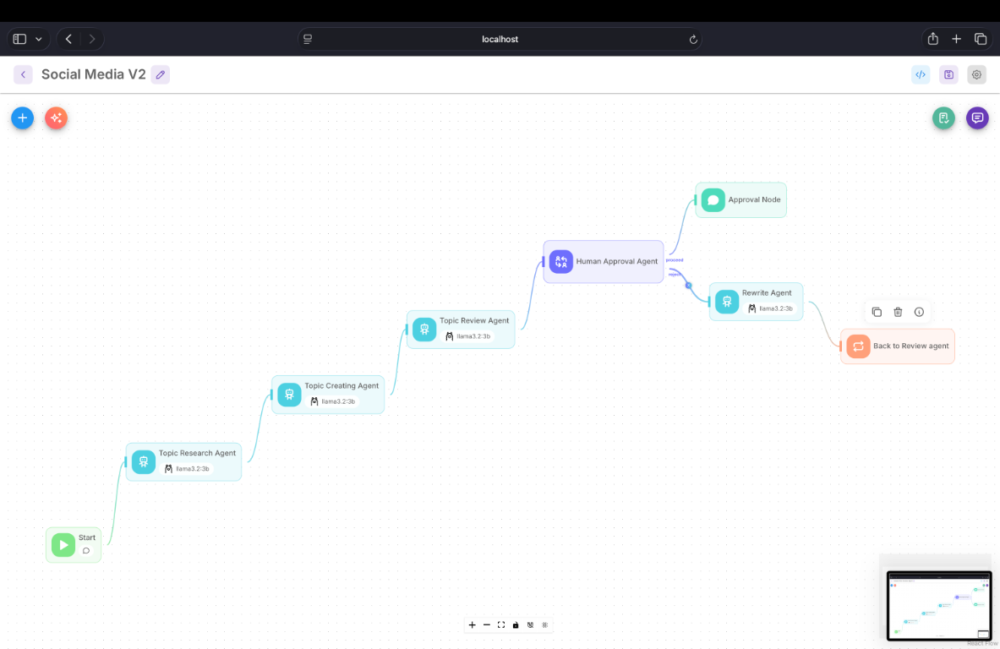
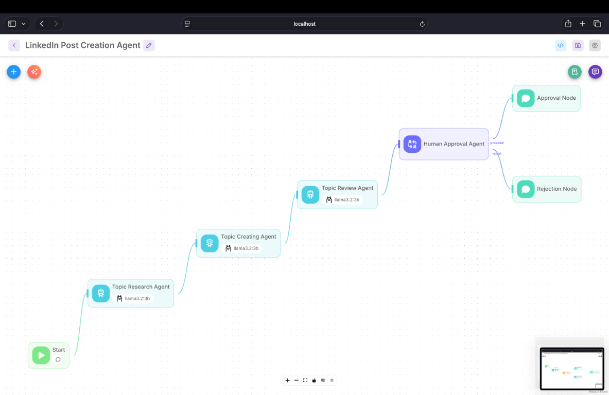
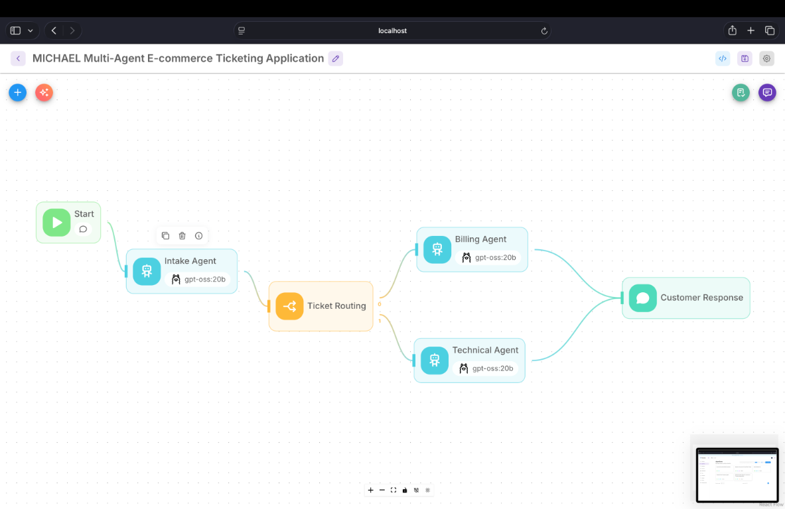

# Applied Artificial Intelligence

AI workflow projects and agent demonstrations.

## Flowise agents

The [`flowise/`](flowise/) folder documents five Flowise workflows:

- [Course Document RAG Assistant](flowise/exports/course-document-rag-assistant.json)
- [Bayesian Insurance Fraud-Risk Triage](flowise/exports/bayesian-insurance-fraud-risk-triage.json)
- [Social Media V2](flowise/exports/social-media-v2.json)
- [LinkedIn Post Creation Agent](flowise/exports/linkedin-post-creation-agent.json)
- [E-commerce ticketing multi-agent workflow](flowise/exports/ecommerce-ticketing-multi-agent.json)

The [Flowise README](flowise/README.md) explains the workflows and shows the screenshots inline. The JSON files are saved workflow definitions that can be imported into Flowise; they describe configuration, not proof that a flow successfully executed. No execution-history files were provided.

The Flowise UI screenshots show a sunset notice. The terminal screenshot records Flowise startup errors; it does not demonstrate a successful startup. See the [Flowise notes](flowise/README.md) for details.

### Workflow previews

| Workflow | Preview |
|---|---|
| Course Document RAG Assistant |  |
| Bayesian Insurance Fraud-Risk Triage |  |
| Social Media V2 |  |
| LinkedIn Post Creation Agent |  |
| E-commerce ticketing |  |
