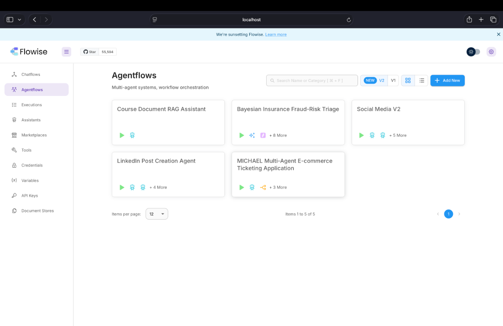
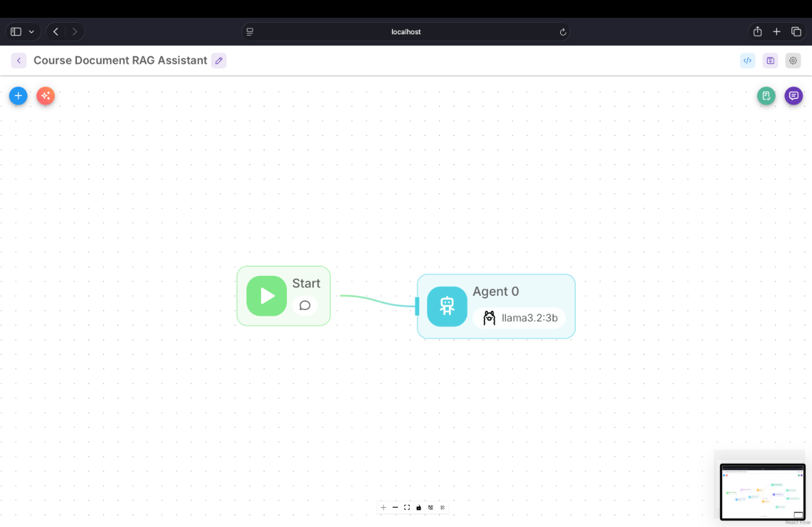
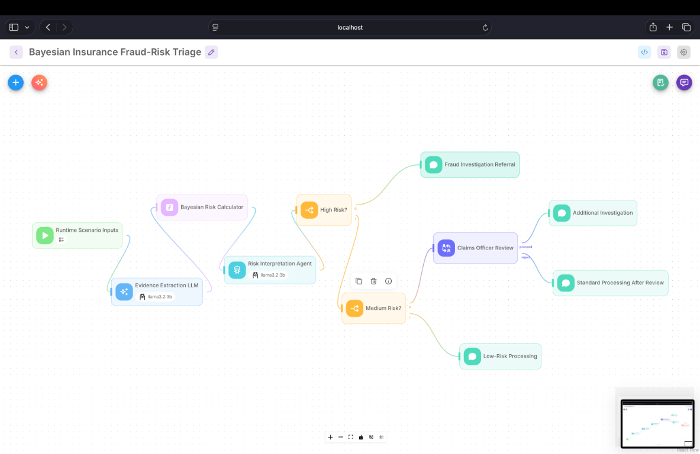
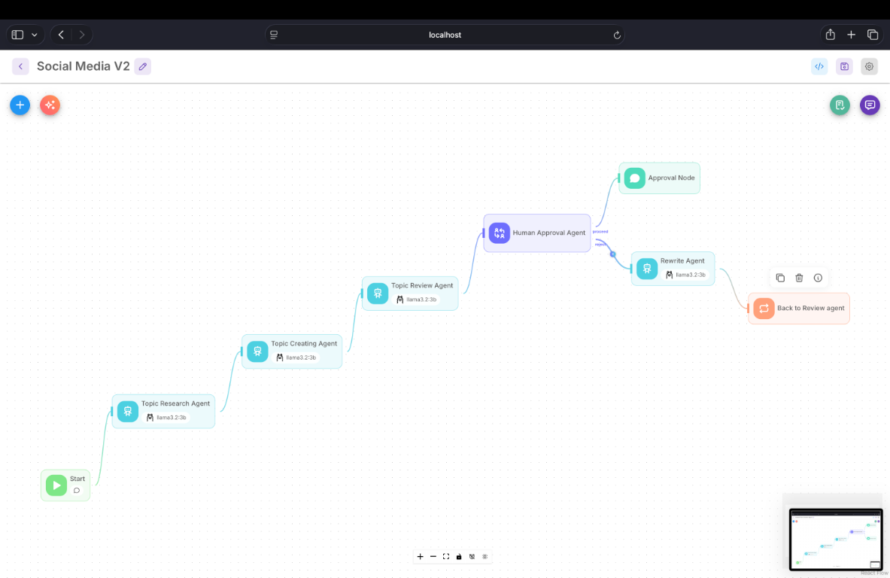
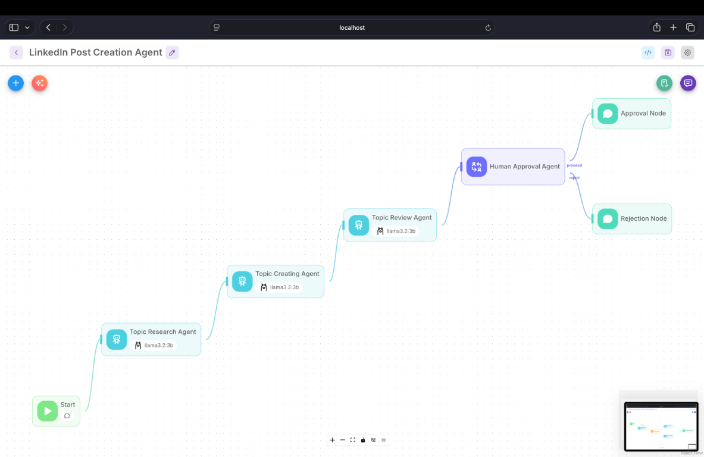
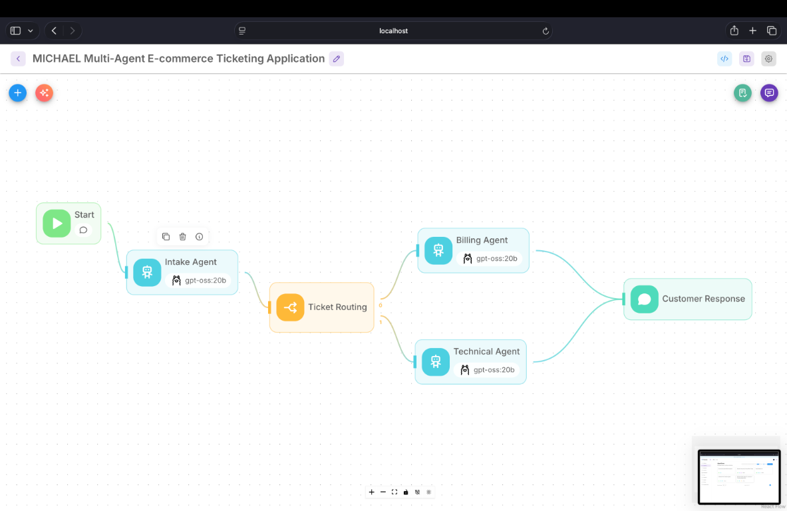

# Flowise Agent Workflows

**Author:** Michael Kelly Osei  
**Platform:** Flowise

A visual portfolio of five Flowise agent workflows. This repository includes screenshots and descriptions only; Flowise export files were not provided, so the workflows cannot be imported or run from this repository.

## Workflows

### Course Document RAG Assistant

A single-agent course-document question-answering flow. The screenshot shows a start node connected to an agent using `llama3.2:3b`.

### Bayesian Insurance Fraud-Risk Triage

A risk-triage flow with runtime scenario inputs, evidence extraction, a Bayesian risk calculator, and a risk-interpretation agent. Conditional routes direct high-risk cases to a fraud-investigation referral, medium-risk cases to claims-officer review, and low-risk cases to low-risk processing. The claims review includes additional-investigation and standard-processing outcomes.

### Social Media V2

A content workflow that researches, creates, and reviews a topic before human approval. Approved content proceeds to an approval node. Rejected content goes through a rewrite agent and back to review.

### LinkedIn Post Creation Agent

A LinkedIn content workflow that researches, drafts, and reviews a topic before human approval. The screenshot shows separate approval and rejection outcomes.

### MICHAEL Multi-Agent E-commerce Ticketing Application

An intake agent routes a customer ticket to a billing or technical agent, then returns a customer response. The visible agent nodes use `gpt-oss:20b`.

## Screenshots

## Local Flowise startup screenshot

The original terminal screenshot is included as requested: [Flowise startup output](https://raw.githubusercontent.com/Michaelkelly71/Applied-Artificial-Intelligence/main/flowise/screenshots/01-flowise-startup-output.png).

In that capture, Flowise reports initialization errors including an `ERR_PACKAGE_PATH_NOT_EXPORTED` for `./utils/uuid` and a missing `@smithy/eventstream-codec` module. Those errors are evidence of the captured startup state; this repository does not include a fix or claim that the local Flowise instance runs successfully. The screenshot also shows a local `HTTP_SECURITY_CHECK=false` environment setting. Do not copy that setting into another environment without understanding its security implications.

The Flowise UI screenshots show a banner stating that Flowise is sunsetting. Check the project's current status before relying on Flowise for a new or long-lived deployment.

## Files and reproducibility

The images document the visible designs, not all node prompts, settings, credentials, or connections. To reproduce or import a workflow, export its Flowise flow definition from Flowise and add that export separately. Never publish API keys, credentials, or private course documents.
